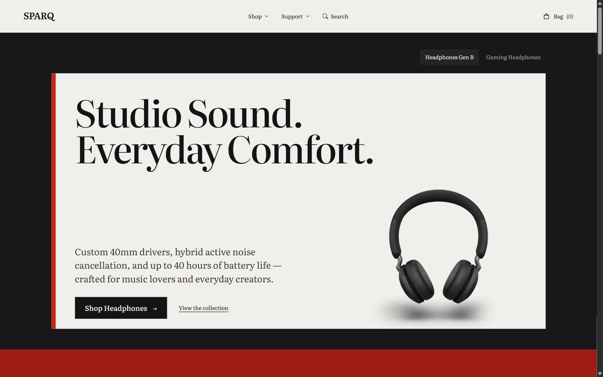
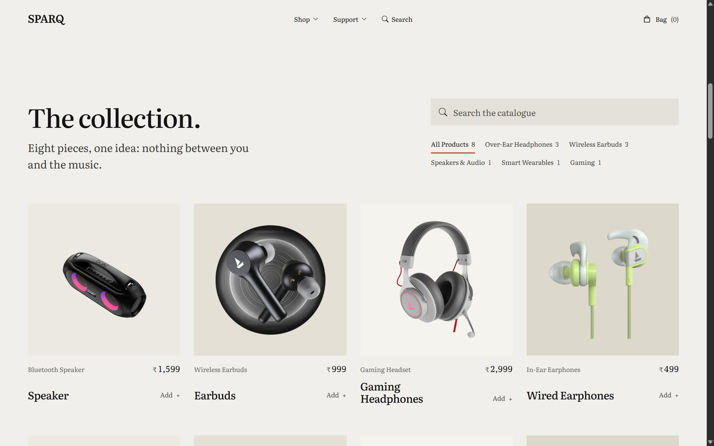
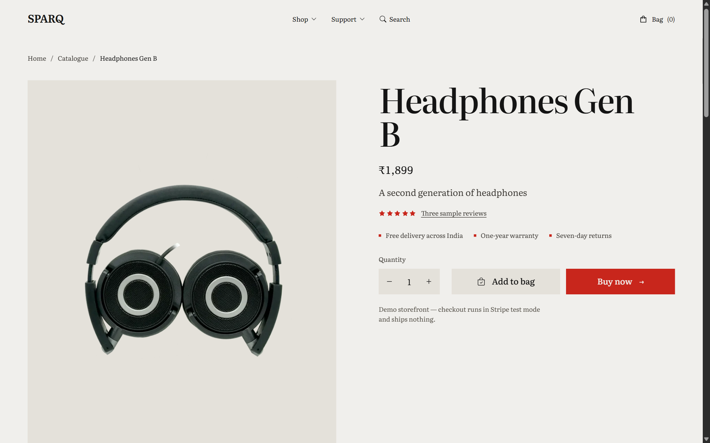
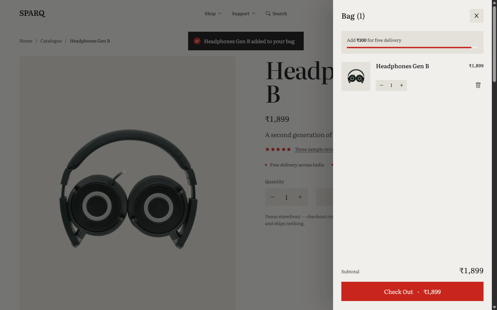
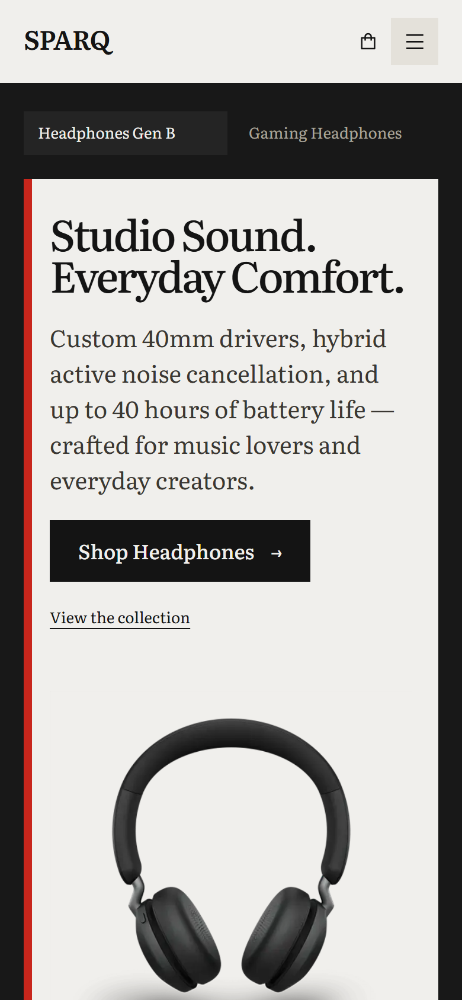

<div align="center">


# SPARQ

> High-performance, headless e-commerce storefront for premium audio gear and wearables, powered by Next.js 12, Sanity CMS Studio, and Stripe Checkout.

[](https://nextjs.org/)
[](https://reactjs.org/)
[](https://www.sanity.io/)
[](https://stripe.com/)
[](https://nodejs.org/)

</div>

---

## Table of Contents

- [About the Project](#about-the-project)
- [Key Features](#key-features)
- [Demo & Visuals](#demo--visuals)
- [Tech Stack](#tech-stack)
- [Project Structure](#project-structure)
- [Prerequisites](#prerequisites)
- [Installation](#installation)
- [Configuration](#configuration)
- [Usage](#usage)
- [API Reference](#api-reference)
- [Running Tests & Quality Assurance](#running-tests--quality-assurance)
- [Deployment](#deployment)
- [Troubleshooting & FAQ](#troubleshooting--faq)
- [Roadmap](#roadmap)
- [Contributing](#contributing)
- [Author & Acknowledgements](#author--acknowledgements)

---

## About the Project

**SPARQ** is a full-stack, headless e-commerce application designed to deliver an ultra-fast, accessible, and conversion-optimized retail experience for consumer audio equipment and wearables.

Traditional e-commerce platforms often suffer from slow server response times, heavy JavaScript bundles, and client-side layout shifts. SPARQ solves this by combining:

- **Next.js Pages Router** with a hybrid rendering model: Server-Side Rendering (SSR) for the dynamic homepage and Incremental Static Regeneration (ISR) for Product Detail Pages.
- **Sanity Studio v2** as a decoupled Headless Content Management System (CMS), enabling structured product, inventory, and promotional banner management without altering application code.
- **Authoritative Server-Side Stripe Checkout**, guaranteeing that product prices and line totals are strictly re-verified against the CMS before generating a payment session.
- **Edge Image Delivery Pipeline**, leveraging `@sanity/image-url` to dynamically resize, format, and compress imagery into WebP at Cloudflare CDN edge nodes.

---

## Key Features

- **Sanity-Managed Product Catalog**: Centralized schema managing multi-angle product photography, names, slugs, INR prices, and technical specifications.
- **Interactive Discovery & Filtering**: Real-time client-side keyword search combined with categorized tab filtering (`All`, `Headphones`, `Earbuds`, `Speakers`, `Wearables`, `Gaming`).
- **Dynamic Product Detail Pages (PDP)**:
  - Multi-image gallery with real-time thumbnail switching and responsive zoom stages.
  - Granular quantity stepper clamped to safe purchasing limits (1–20 units).
  - Editorial description, hardware specifications, and customer review tab navigation.
  - Contextual related products rail.
- **Slide-Over Shopping Bag Drawer**:
  - Global cart state managed through lightweight React Context API.
  - Interactive free-delivery progress meter tracking progress toward the ₹1,999 complimentary shipping threshold.
  - Safe quantity increments, decrements, item deletion, and checkout triggering.
- **Server-Authoritative Stripe Checkout**:
  - Currency strictly calculated in Indian Rupees (INR) with paise conversion (`Math.round(price * 100)`).
  - Client-submitted prices are ignored; prices are fetched authoritatively from Sanity by product ID.
  - In-memory anti-abuse sliding-window rate limiting (15 requests per minute per IP).
- **Stripe Webhook Signature Verification**:
  - Dedicated `/api/webhook` route utilizing raw body buffer parsing (`bodyParser: false`) and cryptographic HMAC SHA-256 signature verification.
- **Complete Accessible Interaction (a11y)**:
  - WAI-ARIA compliant modal drawers (`role="dialog"`, `aria-modal="true"`), focus traps, and keyboard `Escape` dismissal.
  - Semantic tablists (`role="tablist"`, `role="tab"`, `aria-selected`) and screen-reader accessible iconography.
- **Strict Content Security Policy & Hardened Headers**:
  - Built-in CSP in `next.config.js`, including `frame-ancestors 'none'`, `X-Frame-Options: DENY`, `X-Content-Type-Options: nosniff`, and dedicated `worker-src 'self' blob:;`.
- **Core Web Vitals & Performance Engineered**:
  - Desktop Largest Contentful Paint (LCP) under 1.3 seconds.
  - Cumulative Layout Shift (CLS) near zero (`< 0.003`) via explicit aspect ratios and reserved dimensions.
  - Early CDN preconnections to `cdn.sanity.io` and preloaded hero visuals.
- **Static Legal & Policy Pages**:
  - Dedicated, accessible routes for `/privacy-policy`, `/terms-of-use`, `/return-policy`, and custom branded `/404`.

---

## Demo & Visuals

### 1. Storefront Masthead & Editorial Hero
The homepage opens with a dark luxury editorial masthead, featuring the custom SPARQ identity mark, multi-category navigation dropdowns, live search shortcut, and an interactive hero carousel highlighting flagship audio gear.



---

### 2. Live Catalogue Grid & Category Filter Tabs
Interactive catalogue section featuring instant client-side category filtering (`All Products`, `Over-Ear Headphones`, `Wireless Earbuds`, `Speakers & Audio`, `Smart Wearables`, `Gaming`), real-time search filtering, and responsive product cards with formatted INR prices and quick-add actions.



---

### 3. Dynamic Product Detail Page (PDP)
Product pages feature high-resolution photography galleries, breadcrumb hierarchy, instant quantity selectors, value proposition badges (free delivery across India, one-year warranty, seven-day returns), and direct Stripe Checkout triggers.



---

### 4. Slide-Over Shopping Bag Drawer
Accessible slide-over cart drawer with an animated free-delivery progress meter (calculating progress towards the ₹1,999 free shipping threshold), line-item quantity adjusters, instant price recalculation, and a secure "Check Out" action powered by Stripe.



---

### 5. Responsive Mobile Viewport
Fully optimized mobile experience tailored for handheld touch devices (tested at 390×844), with an accessible slide-out navigation panel, compact hero banner, and touch-friendly product tiles.

<p align="center">
  
</p>

*Storefront Brand Icon Asset*: `public/brand/sparq-app-icon.png`

---

## Tech Stack

| Layer | Technology | Version | Purpose |
|---|---|---|---|
| **Frontend Framework** | [Next.js](https://nextjs.org/) | `12.1.0` | React framework (Pages Router, SSR, SSG, ISR, API Routes) |
| **Core UI Library** | [React](https://reactjs.org/) | `17.0.2` | Component architecture and Virtual DOM rendering |
| **Headless CMS** | [Sanity Studio](https://www.sanity.io/) | `^2.29.5` | Decoupled content management studio (separate v2 app) |
| **CMS Client** | [`@sanity/client`](https://www.npmjs.com/package/@sanity/client) | `^3.2.0` | GROQ querying and data fetching |
| **Image Pipeline** | [`@sanity/image-url`](https://www.npmjs.com/package/@sanity/image-url) | `^1.0.1` | Fluent CDN image transformations (WebP, width, quality) |
| **Payment Gateway** | [Stripe Server SDK](https://www.npmjs.com/package/stripe) | `^8.209.0` | Secure Checkout Session generation & webhook processing |
| **Payment Client** | [`@stripe/stripe-js`](https://www.npmjs.com/package/@stripe/stripe-js) | `^1.25.0` | Client-side redirect to Stripe Checkout |
| **State Management** | React Context API | Built-in | In-memory cart items, totals, drawer toggles |
| **Notifications** | [`react-hot-toast`](https://react-hot-toast.com/) | `^2.2.0` | Non-blocking toasts for bag additions and error states |
| **Icons** | [`react-icons`](https://react-icons.github.io/react-icons/) | `^4.3.1` | Accessible vector icons (Ant Design & Bootstrap sets) |
| **Visual Effects** | [`canvas-confetti`](https://www.npmjs.com/package/canvas-confetti) | `^1.5.1` | Celebration particle animations on payment success |
| **Styling** | Vanilla CSS3 | Custom Properties | Global stylesheet (`styles/globals.css`) |
| **Compiler / Minifier** | Next.js SWC | Built-in | Rust-based compiler with `swcMinify: true` |

---

## Project Structure

```text
SPARQ/
├── components/                 # Modular, accessible UI components
│   ├── Cart.jsx                # Slide-over shopping bag drawer & shipping meter
│   ├── ContactForm.jsx         # Customer inquiry form
│   ├── FAQ.jsx                 # Accessible accordion for common customer questions
│   ├── Footer.jsx              # 3-column site navigation, disclaimers & newsletter
│   ├── HeroBanner.jsx          # Masthead carousel with manual slide switching
│   ├── Layout.jsx              # Global head tags, metadata, navbar, and footer wrap
│   ├── Navbar.jsx              # Navigation bar with dropdowns, search, and bag trigger
│   ├── Newsletter.jsx          # Email capture subscription form
│   ├── PolicyLayout.jsx        # Standardized layout for legal and policy documents
│   ├── Product.jsx             # Grid product card with image, price, and category pill
│   ├── Reveal.jsx              # Lightweight IntersectionObserver scroll reveal wrapper
│   ├── ReviewMarquee.jsx       # Verified customer testimonials marquee
│   ├── TrustBar.jsx            # Value proposition badges (shipping, warranty, secure pay)
│   └── index.js                # Clean barrel export for all UI components
├── context/
│   └── StateContext.js         # React Context API provider for shopping bag state
├── lib/
│   ├── categories.js           # Authoritative category registry & matching helpers
│   ├── client.js               # Sanity client configuration and urlFor image builder
│   ├── getStripe.js            # Stripe.js singleton client loader
│   ├── productEditorial.js     # Editorial copy & review fallbacks for catalogue products
│   └── utils.js                # Confetti fireworks animation utility
├── pages/
│   ├── api/
│   │   ├── stripe.js           # Checkout Session endpoint with price re-verification
│   │   ├── verify-session.js   # Endpoint retrieving Stripe session payment status
│   │   └── webhook.js          # Raw-body Stripe webhook receiver and event logger
│   ├── product/
│   │   └── [slug].js           # Dynamic PDP route with SSG + ISR (60s revalidation)
│   ├── 404.js                  # Custom branded Not Found page
│   ├── _app.js                 # Root wrapper with StateContext, Toaster, and Layout
│   ├── _document.js            # Custom HTML document with CDN preconnects & web fonts
│   ├── index.js                # SSR homepage with parallel data fetching & edge caching
│   ├── privacy-policy.js       # Customer privacy policy
│   ├── return-policy.js        # Shipping, return, and warranty terms
│   ├── success.js              # Post-checkout order confirmation and cart reset
│   └── terms-of-use.js         # Terms of service page
├── public/
│   ├── avatars/                # Customer testimonial avatars (Aarav, Priya, Rohan)
│   ├── brand/                  # Vector and high-resolution SPARQ application icons
│   └── screenshots/            # Real high-resolution storefront UI captures for documentation
├── sanity_ecommerce/           # Independent Sanity Studio v2 application
│   ├── schemas/                # Sanity schema definitions (product.js, banner.js)
│   ├── sanity.json             # Sanity project metadata and desk tool configuration
│   └── package.json            # Sanity Studio dependencies and build scripts
├── styles/
│   └── globals.css             # Comprehensive design tokens and global component styling
├── .env.example                # Sanitized environment variable configuration template
├── .eslintrc.json              # ESLint configuration targeting next/core-web-vitals
├── .gitignore                  # Git exclusions for dependencies, profiles, and secrets
├── next.config.js              # Security headers, CSP, SWC minification & cache policies
├── package.json                # Storefront dependencies and build scripts
└── README.md                   # Project documentation
```

---

## Prerequisites

Before running SPARQ locally, ensure your machine satisfies the following runtime requirements:

- **Node.js**: Version `16.0.0` or higher (tested up to Node.js `24.19.0`).
- **npm**: Version `7.0.0` or higher.
- **Sanity Account**: A valid project ID and dataset (default project `jruyr6l6`, dataset `production`).
- **Stripe Account**: A Stripe test account for publishable and secret API keys.

---

## Installation

### 1. Clone the Repository

```powershell
git clone https://github.com/Realadityapathak/SPARQ.git
cd SPARQ
```

### 2. Install Storefront Dependencies

The project uses React 17 with Next.js 12. Run npm with `--legacy-peer-deps`:

```powershell
npm install --legacy-peer-deps
```

### 3. Install Sanity Studio Dependencies

Sanity Studio is a separate application located in the `sanity_ecommerce/` subfolder:

```powershell
cd sanity_ecommerce
npm install --legacy-peer-deps
cd ..
```

---

## Configuration

Copy `.env.example` in the project root to `.env.local`:

```powershell
Copy-Item .env.example .env.local
```

Populate `.env.local` with your valid credentials:

| Variable Name | Description | Required? | Example Value |
|---|---|:---:|---|
| `NEXT_PUBLIC_SANITY_PROJECT_ID` | Sanity Project ID | Yes | `jruyr6l6` |
| `SANITY_API_TOKEN` | Sanity API read/write token (Strictly server-side; never exposed to browser) | Yes | `sk...` |
| `NEXT_PUBLIC_STRIPE_PUBLISHABLE_KEY` | Stripe publishable key used for client redirect | Yes | `pk_test_51...` |
| `STRIPE_SECRET_KEY` | Stripe secret key used to construct checkout sessions | Yes | `sk_test_51...` |
| `STRIPE_WEBHOOK_SECRET` | Stripe webhook signing secret for signature validation | Optional (dev) / Yes (prod) | `whsec_...` |
| `NEXT_PUBLIC_SITE_URL` | Canonical origin of your storefront (validates CORS & redirects) | Yes | `http://localhost:3000` |

> [!WARNING]
> Never commit `.env.local` to version control, expose `SANITY_API_TOKEN` or `STRIPE_SECRET_KEY` to client-side bundles, or prefix secret keys with `NEXT_PUBLIC_`.

---

## Usage

### Development Server

Start the Next.js development server:

```powershell
npm run dev
```

Visit [`http://localhost:3000`](http://localhost:3000) in your browser.

### Sanity Studio (Content Management)

To launch the content management dashboard:

```powershell
cd sanity_ecommerce
npm run start
```

Open [`http://localhost:3333`](http://localhost:3333).

*Note for Node.js 17+ users*: If Sanity Studio v2 fails with `ERR_OSSL_EVP_UNSUPPORTED`, start the studio using the OpenSSL legacy provider flag:

```powershell
$env:NODE_OPTIONS="--openssl-legacy-provider"
npm run start
```

### Production Build & Serve

Compile an optimized production build using Next.js SWC minification:

```powershell
npm run build
npm run start
```

### Code Quality & Linting

Run ESLint against all components, pages, and utility modules:

```powershell
npm run lint
```

---

## API Reference

### 1. Create Checkout Session
* **Route**: `POST /api/stripe`
* **Description**: Validates shopping bag contents, re-fetches authoritative prices from Sanity (excluding drafts), verifies item counts, and creates a Stripe Checkout Session in INR paise.
* **Rate Limit**: 15 requests per minute per IP address (returns `429 Too Many Requests`).
* **Request Body**:
  ```json
  [
    {
      "_id": "4309f8b6-eaad-4462-b221-f738d39086f4",
      "quantity": 2
    }
  ]
  ```
* **Success Response (200 OK)**:
  ```json
  {
    "id": "cs_test_a1b2c3d4...",
    "url": "https://checkout.stripe.com/c/pay/cs_test_..."
  }
  ```
* **Error Responses**:
  - `400 Bad Request`: `EMPTY_CART`, `CART_OVERFLOW` (> 20 items), `INVALID_PAYLOAD`, or `PRODUCT_UNAVAILABLE`.
  - `405 Method Not Allowed`: For non-POST HTTP methods.
  - `429 Too Many Requests`: `RATE_LIMIT_EXCEEDED`.

---

### 2. Verify Checkout Session
* **Route**: `GET /api/verify-session?session_id=<SESSION_ID>`
* **Description**: Retrieves the status of a completed Stripe Checkout Session for order confirmation rendering.
* **Success Response (200 OK)**:
  ```json
  {
    "verified": true,
    "customer_email": "customer@example.com",
    "amount_total": 5998,
    "currency": "inr",
    "status": "paid"
  }
  ```
* **Error Response (400 Bad Request)**:
  ```json
  {
    "error": "INVALID_SESSION",
    "verified": false,
    "message": "Checkout session could not be verified."
  }
  ```

---

### 3. Stripe Webhook Handler
* **Route**: `POST /api/webhook`
* **Description**: Receives asynchronous event notifications from Stripe. Disables Next.js body parsing (`bodyParser: false`) to verify raw HMAC SHA-256 signatures via `stripe.webhooks.constructEvent`.
* **Headers**: `stripe-signature: t=...,v1=...`
* **Success Response (200 OK)**:
  ```json
  {
    "received": true
  }
  ```

---

## Running Tests & Quality Assurance

SPARQ enforces strict linting, type safety, and production build checks to prevent regressions:

### 1. Code Linting & Core Web Vitals Rules

Run ESLint configured with `next/core-web-vitals`:

```powershell
npm run lint
```

### 2. Production Build Verification

Verify that all static routes compile cleanly and that Incremental Static Regeneration (ISR) and SWC minification succeed:

```powershell
npm run build
```

---

## Deployment

SPARQ is ready for production deployment on platforms such as [Vercel](https://vercel.com/) or any containerized/Node.js host:

1. **Build Command**: `npm run build`
2. **Install Command**: `npm install --legacy-peer-deps`
3. **Output Directory**: `.next`
4. **Environment Variables**: Configure all variables from `.env.example` in your production hosting dashboard. Ensure `NEXT_PUBLIC_SITE_URL` matches your custom production domain (e.g. `https://sparq.tech`).
5. **Stripe Webhook Registration**: In the Stripe Dashboard, create an endpoint targeting `https://<YOUR_DOMAIN>/api/webhook` listening for `checkout.session.completed` and add the generated signing secret as `STRIPE_WEBHOOK_SECRET`.

---

## Troubleshooting & FAQ

#### 1. Sanity Studio fails with `ERR_OSSL_EVP_UNSUPPORTED`
* **Cause**: Node.js 17+ uses OpenSSL 3.0, which disables legacy crypto algorithms used by older Webpack configurations inside Sanity Studio v2.
* **Solution**: Run Sanity Studio with the OpenSSL legacy provider flag:
  ```powershell
  $env:NODE_OPTIONS="--openssl-legacy-provider"
  npm run start
  ```

#### 2. npm install throws peer dependency conflicts
* **Cause**: React 17 dependencies conflicting with newer npm resolution algorithms.
* **Solution**: Always append `--legacy-peer-deps` when installing root or studio packages:
  ```powershell
  npm install --legacy-peer-deps
  ```

#### 3. Checkout shows "Demo Mode: Simulating checkout flow"
* **Cause**: `STRIPE_SECRET_KEY` or `NEXT_PUBLIC_STRIPE_PUBLISHABLE_KEY` is not defined in `.env.local`.
* **Solution**: Add your test API keys from the Stripe Dashboard to `.env.local` and restart the development server.

#### 4. API requests return HTTP 429 Too Many Requests
* **Cause**: The sliding-window rate limiter in `/api/stripe` received more than 15 requests within 60 seconds from the same IP address.
* **Solution**: Wait 60 seconds for the sliding window to expire, or adjust `MAX_REQUESTS_PER_WINDOW` in `pages/api/stripe.js`.

---

## Roadmap

- [ ] **Sanity Studio v3 Migration**: Upgrade the Studio app in `sanity_ecommerce/` to Sanity Studio v3 for native Node 20/24 compatibility without legacy OpenSSL flags.
- [ ] **Webhook Order Persistence**: Create mutations in `pages/api/webhook.js` to persist confirmed orders into a Sanity `order` schema upon `checkout.session.completed`.
- [ ] **Cart Persistence**: Synchronize React Context cart state with `localStorage` or encrypted cookies across browser refreshes.
- [ ] **Customer Authentication**: Introduce authenticated user profiles and past order history lookup.
- [ ] **AVIF Image Format Support**: Extend `@sanity/image-url` pipelines to negotiate AVIF for supporting browsers.

---

## Contributing

Contributions to SPARQ are welcome:

1. Fork the repository.
2. Create a descriptive feature branch:
   ```powershell
   git checkout -b feature/your-feature-name
   ```
3. Commit your modifications using clear commit messages:
   ```powershell
   git commit -m "feat: add your feature description"
   ```
4. Verify code quality and ensure zero regressions:
   ```powershell
   npm run lint
   npm run build
   ```
5. Push to your branch and open a Pull Request.

---

## Author & Acknowledgements

* **Author**: Aditya Pathak — [@realadityapathak](https://github.com/realadityapathak)
* **Repository**: [https://github.com/Realadityapathak/SPARQ](https://github.com/Realadityapathak/SPARQ)
* **Support**: For inquiries and questions regarding this reference storefront, contact `support@sparq.tech`.
* **Acknowledgements**:
  - The [Next.js](https://nextjs.org/) team at Vercel.
  - The [Sanity.io](https://www.sanity.io/) team for headless content infrastructure.
  - The [Stripe Developer](https://stripe.com/) community.
